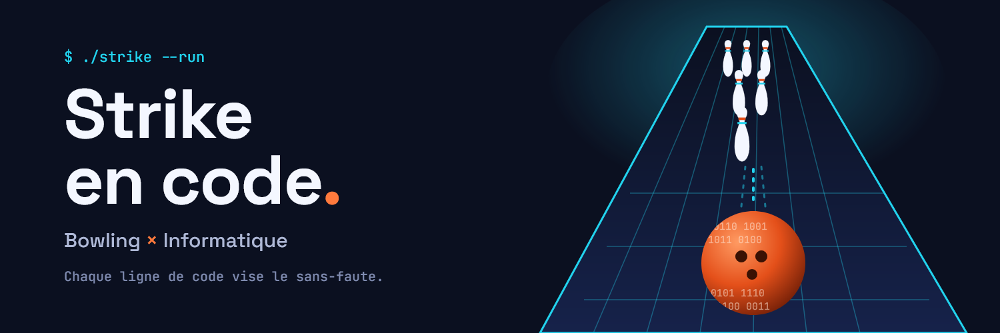

  

Naël Legagneux--Bequet

Je suis étudiant en première année d'informatique chez Coda. Dans la vie, je m'intéresse à beaucoup de domaines différents, que ce soit la musique, la tech ou le sport  et particulièrement le bowling qui est une passion transmise par mon père et qui aujourd'hui occupe une place importante dans ma vie.

Au sein de l'informatique, ce qui m'attire tout particulièrement, c'est l'univers de la Data et de l'Intelligence Artificielle. Comprendre comment on exploite les données, comment elles permettent d'entraîner des modèles et comment s'en servir concrètement est ce qui me donne envie d'avancer et de me spécialiser dans cette voie.

Mon objectif
Je suis à la recherche d'une alternance dans le domaine de la Data ou de l'IA pour l'année prochaine, afin d'apprendre directement sur le terrain et de monter en compétences sur des projets réels.

Ce que je travaille en ce moment
* Domaines d'intérêt : Analyse de données, bases de données, Intelligence Artificielle.
* Outils et langages : Python, SQL, Git, GitHub, Linux (à ajuster selon tes cours actuels).
* Parcours : Acquisition des bases de l'informatique chez Coda et premiers projets pratiques.

Me contacter
Si vous avez des opportunités d'alternance, des conseils à partager ou simplement envie d'échanger :
* Email : nael9791@gmail.com
* LinkedIn :
* Portfolio :

  

  
  
  

